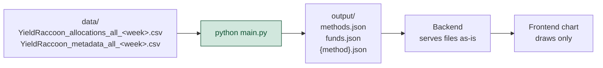

# FundClustering

Python pipeline that groups equity funds by their country + sector allocations and writes the results to `output/` as precomputed JSON. The files are a draw-only data contract for the fund cluster map: every number is computed here, consumers only read and display.

> **TL;DR:** read `output/methods.json` first, then `output/funds.json`, then the method file it names (e.g. `cosine.json`). Join everything on `isin`. `cluster: -1` means "not in a cluster".

---

## 📋 Overview

Fund categories from the source (e.g. `Branschfond, Ny teknik`) are too broad to find truly similar funds. This tool clusters funds on what they actually hold, then compares the clusters with the existing categories.

- **Clusters** — groups of funds with a similar country + sector mix; the algorithm decides how many.
- **Verdicts** — per fund: does its cluster agree with its own category?
- **Nearest neighbours** — the 20 most similar funds per fund, for similarity search.
- **Map layout** — 2D coordinates, label positions and cluster background areas, ready to draw.

## 🏗️ How it's used



1. YieldRaccoon exports two CSVs per ISO week into `data/` (allocations + metadata).
2. `main.py` joins them on `isin`, keeps `fund_type == EQUITY_FUND`, runs every clustering method and writes `output/`.
3. The files are regenerated each week and replaced as a whole. `data/` and `output/` are git-ignored.

```bash
python main.py                      # newest week in data/ → output/
python main.py --week 2026-W44      # a specific week
python main.py --input DIR --output DIR
```

---

## 📁 Output files

| File | Read | Contents |
| --- | --- | --- |
| `methods.json` | first | Manifest: which method files exist and which one is the default |
| `funds.json` | once | Display data per fund, shared by all methods |
| `{method}.json` | per method | Everything one clustering method produced: points, clusters, categories, territory, neighbours |

Today there are two methods, `cosine` (`cosine.json`, the default) and `aitchison` (`aitchison.json`). More may be added; **discover them from `methods.json`, never hard-code file names**.

### Conventions

- UTF-8, compact JSON, camelCase keys.
- Every file has `week`: the ISO week of the source data, e.g. `"2026-W44"`. All files in one `output/` share it.
- Funds appear in the same order everywhere: sorted by `isin`. `funds.json.funds[i]` and `{method}.json.points[i]` are the same fund.
- Computed numbers are rounded to 4 decimals; allocation percentages to 2.
- `cluster: -1` = not in a cluster (HDBSCAN noise). Such funds have no cluster entry and are excluded from shares.
- Category strings are verbatim Swedish labels from the source (e.g. `Sverige, Små-/medelstora bolag`). Treat them as opaque ids; never merge or normalise them.

---

## 🔌 Schema

### `methods.json`

```json
{
  "week": "2026-W44",
  "default": "cosine",
  "methods": [
    { "id": "cosine", "name": "Cosine", "file": "cosine.json" },
    { "id": "aitchison", "name": "Aitchison", "file": "aitchison.json" }
  ]
}
```

| Field | Type | Meaning |
| --- | --- | --- |
| `default` | string | Method `id` to show first |
| `methods[].id` | string | Method id, also the file's base name |
| `methods[].name` | string | Display name |
| `methods[].file` | string | File name in the same folder |

### `funds.json`

```json
{
  "week": "2026-W44",
  "funds": [
    {
      "isin": "SE0000000001",
      "name": "Example Index Fund",
      "company": "Example Asset Mgmt",
      "category": "USA, Mix bolag",
      "family": "usa",
      "shade": 2,
      "isIndex": true,
      "topCountries": [["usa", 99.19], ["schweiz", 0.35]],
      "topSectors": [["teknik", 37.28], ["finans", 13.01]]
    }
  ]
}
```

| Field | Type | Meaning |
| --- | --- | --- |
| `isin` | string | Fund id; join key for everything |
| `name`, `company` | string | Fund and fund company names as delivered |
| `category` | string | Source category, verbatim |
| `family` | string | Category family id, see [Families](#families) |
| `shade` | int | 0-based position of the category among its family's categories, alphabetical. Lets a chart give region variants different shades of the family colour |
| `isIndex` | bool | Index fund |
| `topCountries`, `topSectors` | `[name, percent][]` | Up to 4 largest allocations, largest first. Zeros dropped, `country_`/`sector_` prefix removed, names lower-case Swedish. Percent as delivered: can be negative (short positions) |

### `{method}.json`

Top level:

| Field | Type | Meaning |
| --- | --- | --- |
| `method`, `name` | string | Method id and display name |
| `description` | string | One-sentence explanation of the method, for a tooltip |
| `summary` | object | Headline numbers for the whole map |
| `points` | array | One per fund, same order as `funds.json` |
| `clusters` | array | One per cluster, sorted by `id` |
| `categories` | array | One per source category, sorted by name |
| `territory` | array | Background polygons per cluster |
| `neighbours` | object | ISIN → most similar funds |

<details>
<summary><b>Trimmed example</b></summary>

```json
{
  "week": "2026-W44",
  "method": "cosine",
  "name": "Cosine",
  "description": "Each fund vector scaled to length 1, ...",
  "summary": { "funds": 787, "clusters": 47, "notInCluster": 47, "agree": 0.6514, "neighbouring": 0.1662, "different": 0.1824, "ari": 0.3961, "nmi": 0.7582 },
  "points": [{ "isin": "SE0000000001", "x": 0.3643, "y": 0.6525, "cluster": 36, "verdict": "agree", "isolated": false }],
  "clusters": [{ "id": 0, "name": "Indien", "size": 20, "purity": 1.0, "leadingCategory": "Indien", "labelX": 0.2485, "labelY": 0.7768, "categories": { "Indien": 20 } }],
  "categories": [{ "category": "ASEAN", "family": "asia", "funds": 4, "agreeShare": 1.0 }],
  "territory": [{ "cluster": 0, "rings": [[[0.19, 0.75], [0.185, 0.75], "...", [0.19, 0.75]]] }],
  "neighbours": { "SE0000000001": [{ "isin": "SE0000000002", "distance": 0.0305 }] }
}
```

</details>

#### `summary`

| Field | Type | Meaning |
| --- | --- | --- |
| `funds` | int | All funds on the map |
| `clusters` | int | Number of clusters found |
| `notInCluster` | int | Funds with `cluster: -1` |
| `agree`, `neighbouring`, `different` | 0..1 | Share of **clustered** funds with that verdict; the three sum to 1 |
| `ari`, `nmi` | number \| null | Adjusted Rand Index and Normalised Mutual Information between clusters and categories, clustered funds only. 1 = clusters reproduce the categories exactly. `null` if nothing is clustered |

#### `points[]`

| Field | Type | Meaning |
| --- | --- | --- |
| `isin` | string | Fund |
| `x`, `y` | number | Map position, see [Map coordinates](#map-coordinates) |
| `cluster` | int | Cluster `id`, or `-1` |
| `verdict` | string | `agree` \| `neighbouring` \| `different` \| `none`, see [Verdicts](#verdicts) |
| `isolated` | bool | Fund has few close neighbours (top 5% by distance to its 5th nearest neighbour) |

#### `clusters[]`

| Field | Type | Meaning |
| --- | --- | --- |
| `id` | int | Cluster id (≥ 0), referenced by `points[].cluster` and `territory[].cluster` |
| `name` | string | Display name, see [Cluster names](#cluster-names) |
| `size` | int | Funds in the cluster |
| `purity` | 0..1 | Share of the cluster's funds in `leadingCategory` |
| `leadingCategory` | string | Most common category in the cluster |
| `labelX`, `labelY` | number | Where to put the name: median of member positions |
| `categories` | object | Category → fund count, most common first |

#### `categories[]`

| Field | Type | Meaning |
| --- | --- | --- |
| `category` | string | Source category |
| `family` | string | Family id |
| `funds` | int | All funds in the category, clustered or not |
| `agreeShare` | 0..1 \| null | Share of the category's **clustered** funds whose verdict is `agree`. `null` if none of its funds is clustered |

#### `territory[]`

| Field | Type | Meaning |
| --- | --- | --- |
| `cluster` | int | Cluster id. A cluster can have several entries when its area is split |
| `rings` | `[x, y][][]` | One polygon: `rings[0]` is the outer boundary, any further rings are holes. Each ring is closed (first point = last point) |

Polygons are built from a grid (~220 cells across the map, padded 0.05 around all funds), so edges are axis-aligned steps and can reach slightly below 0 or above the funds' maximum. Each cell belongs to the cluster with the strongest inverse-distance vote among its 7 nearest clustered funds within 0.05; unclustered funds never vote, and cells without voters are empty. Fill with even-odd or orient holes opposite to the outer ring.

#### `neighbours`

`{ "<isin>": [{ "isin": "<other isin>", "distance": 0.0305 }, ...] }`

- Every fund has an entry, including unclustered ones.
- 20 most similar other funds, closest first. A fund is never its own neighbour; ties keep ISIN order.
- `distance` is measured in the method's feature space. It is **not** the distance on the 2D map, and the scale differs per method:
  - `cosine`: Euclidean between unit-length allocation vectors, 0..2, ranks the same as cosine distance. Typical closest match ≈ 0.1.
  - `aitchison`: Aitchison distance (Euclidean between centred log-ratio vectors), 0 and up with no fixed maximum. Typical closest match ≈ 3.
- This is the answer to "which funds are most similar to X?". Example: a fund's 5 most similar funds are `neighbours[isin].slice(0, 5)`.

---

## 🔍 Finding similar funds

1. Find the fund's `isin` in `funds.json` (search `name` or `isin`).
2. Load the default method file from `methods.json`.
3. `neighbours[isin]` is the answer: up to 20 funds, closest first. Join each `isin` to `funds.json` for display.

- `distance: 0` = identical allocations, often another share class of the same fund.
- `points[i].isolated: true` = even the best matches are far away; flag results as weak.
- For more than 20, add funds with the same `points[].cluster` (not `-1`).
- `topCountries` / `topSectors` side by side give a simple "why similar".
- Don't use map `x`/`y` for similarity, and don't compare distances across methods.
- Similarity is allocations only: two funds with the same theme but different holdings won't match.

---

## 🧭 What the values mean

### Map coordinates

`x`, `y` come from a 2D UMAP projection, tuned to spread dots out for readability. Both axes use the same scale; the longer axis spans 0..1, the shorter 0..(its length). Preserve the aspect ratio when drawing. Positions show rough structure only: close dots are usually similar, but use `neighbours` for actual similarity.

### Clusters

Clusters come from HDBSCAN on a separate 10-dimensional UMAP of the same features, so a cluster can look scattered on the 2D map. HDBSCAN picks the number of clusters itself; funds outside any dense group get `-1`. UMAP is seeded (`random_state=42`), so the same input gives the same output, but cluster ids and names are **not stable across weeks**; match funds by `isin`, not clusters by `id`.

### Cluster names

- The name is the cluster's most common category.
- When purity is under 50%: `Mixed · <top category> / <second category>`.
- Several clusters with the same name get suffixes by size: `Sverige · A` (largest), `Sverige · B`, …

### Families

Each category belongs to one family, decided by the text before the first comma.

| `family` | Display name | Category prefixes |
| --- | --- | --- |
| `nordic` | Nordics | Sverige, Norden, Norge, Finland, Global & Sverige |
| `europe` | Europe | Europa, Euroland, Tyskland, Italien, Spanien, Storbritannien, Östeuropa ex Ryssland |
| `usa` | USA | USA |
| `global` | Global | Global |
| `em` | Emerging markets | Tillväxtmarknader*, Latinamerika, Brasilien, Afrika och Mellanöstern, Indien |
| `asia` | Asia & Japan | Japan, Kina*, Asien*, Hongkong, Taiwan, Korea, ASEAN, Indonesien, Vietnam |
| `sector` | Sector funds | Branschfond (the part after the comma is the industry) |
| `other` | Other | Övriga aktiefonder, Lång/kort, and any unknown category |

`*` = prefix match (e.g. `Asien ex Japan`). All families except `sector` and `other` are **regional**.

### Verdicts

Each fund's category is compared with its cluster's `leadingCategory`:

| `verdict` | Rule | Meaning |
| --- | --- | --- |
| `agree` | own category = leading category | Clustering confirms the category |
| `neighbouring` | different category, same **regional** family | Close variant, e.g. a Nordic fund in a Sverige-led cluster |
| `different` | different family, or two different sector industries | Holdings look like another kind of fund; the interesting disagreements |
| `none` | `cluster: -1` | Not in a cluster; excluded from all shares |

### Methods

A method is a way of turning a fund's allocations into a feature vector. All methods share the same clustering, naming and layout steps.

| `id` | Features |
| --- | --- |
| `cosine` | All country + sector percentages as one vector (no weighting between the two blocks), scaled to length 1. Compares the *mix* of holdings. Negative values (short positions) used as reported |
| `aitchison` | Centred log-ratio of the country shares and, separately, of the sector shares (`log(p + 0.005)` minus its mean), then joined. Compares *ratios* between holdings, so small positions count as much as large ones. Negative values read as 0 |

Each method lives in its own module under [fund_clustering/methods/](fund_clustering/methods/) as a `Method` (id, name, description and a `features` function). The pipeline only calls `method.features(data)`, so methods are interchangeable.

To add a method, write `fund_clustering/methods/{id}.py` with its feature function and a `METHOD`, then list it in `METHODS` in [fund_clustering/methods/\_\_init\_\_.py](fund_clustering/methods/__init__.py). It gets its own `{id}.json` and a manifest entry; the first entry in `METHODS` is the default. Euclidean distance between feature rows must be the method's distance, because UMAP and the neighbour search use Euclidean distance.

---

## 👀 Viewer

[viewer/index.html](viewer/index.html) is a proof-of-concept map of the files in `output/`, the way the app will draw them. Open it straight from disk (`file:///…/FundClustering/viewer/index.html`), no server needed:

1. Click **Choose files** (or drop files on the page) and pick `methods.json`, `funds.json` and every method file from `output/`.
2. Switch methods with the **Method** selector. A method file you didn't pick brings the picker back; pick it and the map switches to it.

Browsers block `fetch()` from `file://` pages, hence the picker. Served over http, the page loads `../output/` by itself. ECharts and the font come from a CDN, so it needs internet.

---

## 🚀 Development

Requires Python 3.15+.

```bash
python -m venv .venv
.venv\Scripts\activate          # Windows
pip install -e .[dev]

python main.py                  # needs the weekly CSVs in data/
pytest                          # all tests
pytest -m "not slow"            # skip the UMAP tests
```

| Module | Step |
| --- | --- |
| `fund_clustering/load.py` | Read and join the weekly CSVs, keep equity funds |
| `fund_clustering/methods/` | One module per method: allocations → feature vectors; `METHODS` registry |
| `fund_clustering/cluster.py` | UMAP + HDBSCAN clusters, 2D map coordinates |
| `fund_clustering/naming.py` | Families, cluster names, verdicts |
| `fund_clustering/neighbours.py` | Nearest neighbours, isolated flag |
| `fund_clustering/territory.py` | Territory grid and polygons |
| `fund_clustering/pipeline.py` | One method end to end |
| `fund_clustering/export.py` | Writes the JSON files described above |

## 📚 Related docs

- [Fund clustering for similarity search](../docs/Fund%20clustering%20for%20similarity%20search.md) — design notes, methods tried, results and next steps
- [YieldRaccoon](../YieldRaccoon/README.md) — the app that produces the weekly CSV exports
