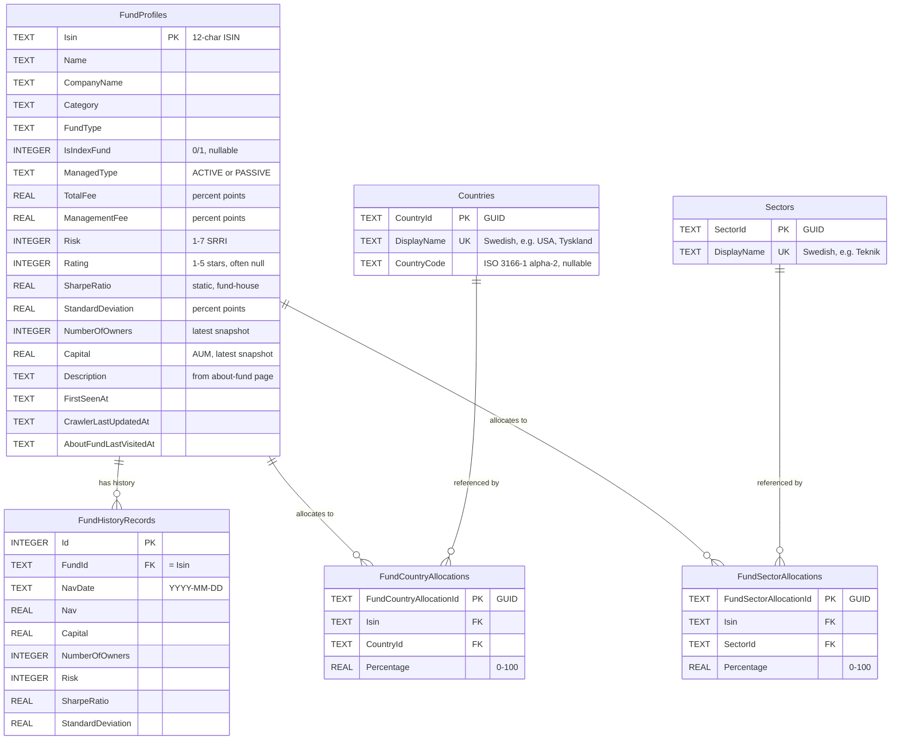

# Fund Database — Agent Guide

Concise schema reference for AI agents reading the YieldRaccoon SQLite database directly. Optimized for inclusion in agent context — read top-down, stop when you have what you need.

## Overview

Single SQLite file (`YieldRaccoon.db`) written by the YieldRaccoon WPF crawler. Six tables in two clusters:

| Cluster | Tables | Lifecycle |
|---|---|---|
| Fund identity & history | `FundProfiles`, `FundHistoryRecords` | Profile = static (rare updates). History = append-only time series, one row per `(FundId, NavDate)`. |
| Portfolio allocations | `Countries`, `Sectors`, `FundCountryAllocations`, `FundSectorAllocations` | Lookup tables grow organically. Allocation tables hold **latest snapshot only** — re-ingestion deletes pairs missing from the new payload. No history. |

Join key for everything fund-side: `Isin` (12-char string, e.g. `SE0000000001`).

> **Provenance:** all data is ingested from a public Swedish source. Country/sector display names are in Swedish (`Sverige`, `Hälsovård`, `Råvaror`). Currency is whatever the source reports — usually `SEK`. The ingestion pipeline is the only writer; the database is read-only from any other tool's perspective.

## ER diagram



## Per-table schemas

### FundProfiles (aggregate root)

One row per fund. Keyed by `Isin`. Updated by the list crawler on each pass; `Description` is updated only by the about-fund orchestrator (preserved during list-crawl upserts).

| Column | Type | Unit | Nullable | Meaning |
|---|---|---|---|---|
| `Isin` | TEXT(12) | — | no | ISO 6166 fund identifier — primary key, fixed length |
| `Name` | TEXT(500) | — | no | Display name |
| `OrderbookId` | TEXT(50) | — | yes | External orderbook identifier |
| `Category`, `CompanyName`, `FundType` | TEXT | — | yes | Fund classification + asset manager |
| `IsIndexFund` | INTEGER | 0/1 | yes | SQLite boolean (read with `IsIndexFund = 1`) |
| `CurrencyCode` | TEXT(10) | ISO 4217 | yes | Reporting currency, usually `SEK` |
| `ManagedType` | TEXT(20) | enum | yes | `ACTIVE` or `PASSIVE` (upper-case literal) |
| `StartDate` | TEXT | YYYY-MM-DD | yes | Inception date (stored as text, not DATE) |
| `Buyable`, `HasCashDividends`, `HasCurrencyExchangeFee`, `LowCarbon` | INTEGER | 0/1 | yes | Booleans |
| `RecommendedHoldingPeriod` | TEXT(50) | enum | yes | Upper-case enum: `ONE_YEAR`, `THREE_YEAR`, `FIVE_YEAR`, `TEN_YEAR` |
| `ManagementFee`, `TotalFee`, `TransactionFee`, `OngoingFee` | REAL | **percent points** | yes | `1.25` means 1.25 %, **not** 0.0125 |
| `MinimumBuy`, `Capital` | REAL | currency units | yes | Minimum buy amount + AUM in `CurrencyCode` |
| `NumberOfOwners` | INTEGER | count | yes | Latest snapshot — also tracked over time in `FundHistoryRecords` |
| `Rating` | INTEGER | 1–5 | yes | Star rating — **frequently null** for newer funds |
| `Risk` | INTEGER | 1–7 | yes | SRRI/SRI risk indicator |
| `SharpeRatio`, `StandardDeviation` | REAL | ratio / percent | yes | **Static fund-house-published values** — not computed time-series |
| `SustainabilityLevel` | TEXT(20) | enum | yes | `WORSE`, `AVERAGE`, `BETTER` |
| `SustainabilityRating` | INTEGER | 1–5 | yes | Sustainability star rating |
| `EsgScore`, `EnvironmentalScore`, `SocialScore`, `GovernanceScore` | REAL | score | yes | ESG pillars (scale matches source) |
| `EuArticleType` | TEXT(50) | enum | yes | EU SFDR Article 6/8/9 classification |
| `FirstSeenAt` | TEXT | ISO 8601 | no | When fund was first discovered by the crawler |
| `CrawlerLastUpdatedAt` | TEXT | ISO 8601 | yes | List-crawler heartbeat. Funds with null or older-than-1-month value are treated as delisted by the about-fund scheduler. |
| `AboutFundLastVisitedAt` | TEXT | ISO 8601 | yes | About-fund orchestrator scheduling cursor (least-recently-visited prioritized) |
| `Description` | TEXT(4000) | — | yes | Prose description from the about-fund page; only the about-fund orchestrator writes it |

### FundHistoryRecords (time series)

One row per `(FundId, NavDate)` pair — guaranteed unique by `UX_FundHistoryRecords_FundId_NavDate`. Append-only: existing rows are not updated, missing pairs are not back-filled.

| Column | Type | Unit | Nullable | Meaning |
|---|---|---|---|---|
| `Id` | INTEGER | — | no | Auto-increment surrogate PK |
| `FundId` | TEXT | — | no | FK → `FundProfiles.Isin` (cascade delete) |
| `NavDate` | TEXT | YYYY-MM-DD | yes (in schema, but always set in practice) | NAV calculation date — Stockholm time, holidays/weekends absent |
| `Nav` | REAL | currency / share | yes | Net asset value per share |
| `Capital` | REAL | currency units | yes | AUM at the snapshot date |
| `NumberOfOwners` | INTEGER | count | yes | Investor count at the snapshot date |
| `Risk` | INTEGER | 1–7 | yes | SRRI at the snapshot date |
| `SharpeRatio`, `StandardDeviation` | REAL | ratio / percent | yes | Static fund-house values at the snapshot date — usually unchanged across consecutive rows |

**Indexes:**

- `IX_FundHistoryRecords_FundId_NavDate` (FundId, NavDate **DESC**) — query latest-first by fund
- `UX_FundHistoryRecords_FundId_NavDate` (FundId, NavDate) UNIQUE — enforces one row per fund per day

### Countries (lookup)

Grows organically — a row is inserted the first time a country is seen in any fund's portfolio payload.

| Column | Type | Unit | Nullable | Meaning |
|---|---|---|---|---|
| `CountryId` | TEXT (GUID) | — | no | Primary key |
| `DisplayName` | TEXT(200) | — | no | Swedish source name (`USA`, `Sverige`, `Tyskland`) — **unique-indexed**, case-sensitive |
| `CountryCode` | TEXT(2) | ISO 3166-1 alpha-2 | yes | Filled when the source provides it. Backfilled on re-crawl when a non-null code arrives; **never overwritten with null**. |

### Sectors (lookup)

Same shape and growth model as `Countries`, minus the ISO code.

| Column | Type | Unit | Nullable | Meaning |
|---|---|---|---|---|
| `SectorId` | TEXT (GUID) | — | no | Primary key |
| `DisplayName` | TEXT(200) | — | no | Swedish source name (`Teknik`, `Hälsovård`, `Råvaror`) — **unique-indexed**, case-sensitive |

### FundCountryAllocations / FundSectorAllocations (latest snapshot)

Symmetric tables. One row per `(Isin, CountryId)` or `(Isin, SectorId)`. Re-ingestion is **diff-based**:

- New pairs → inserted
- Existing pairs with changed percentage → updated
- Pairs missing from the new payload → **deleted**

No history retained.

| Column (country variant shown — sector variant identical with `SectorId`) | Type | Unit | Nullable | Meaning |
|---|---|---|---|---|
| `FundCountryAllocationId` | TEXT (GUID) | — | no | Primary key |
| `Isin` | TEXT(12) | — | no | FK → `FundProfiles.Isin` (**cascade delete**) |
| `CountryId` | TEXT (GUID) | — | no | FK → `Countries.CountryId` (**restrict delete** — can't drop a country still referenced by any fund) |
| `Percentage` | REAL | percent (0–100) | no | Share of the fund's portfolio allocated to this country/sector |

**Indexes:** unique on `(Isin, CountryId)` / `(Isin, SectorId)` to prevent duplicate pairs; secondary index on `CountryId` / `SectorId` for reverse lookups ("which funds hold X").

> **Empty does not mean zero.** A fund whose portfolio page hasn't been crawled has **zero rows** in both allocation tables. A fund that legitimately holds 0 % of a category has **no row for that category** — the source page only emits non-zero entries. Distinguish "uncrawled" from "no exposure" by counting allocation rows for the fund: total = 0 → uncrawled.

## Common joins

```sql
-- Latest NAV per fund
SELECT fp.Isin, fp.Name, fhr.NavDate, fhr.Nav
FROM FundProfiles fp
JOIN FundHistoryRecords fhr ON fhr.FundId = fp.Isin
WHERE fhr.NavDate = (
    SELECT MAX(NavDate) FROM FundHistoryRecords WHERE FundId = fp.Isin
);

-- All country allocations for a fund (with display names)
SELECT c.DisplayName AS Country, c.CountryCode, fca.Percentage
FROM FundCountryAllocations fca
JOIN Countries c ON c.CountryId = fca.CountryId
WHERE fca.Isin = ?
ORDER BY fca.Percentage DESC;

-- Funds with > 50% allocation to a given sector
SELECT fp.Isin, fp.Name, fsa.Percentage
FROM FundSectorAllocations fsa
JOIN Sectors s ON s.SectorId = fsa.SectorId
JOIN FundProfiles fp ON fp.Isin = fsa.Isin
WHERE s.DisplayName = 'Teknik' AND fsa.Percentage > 50
ORDER BY fsa.Percentage DESC;

-- Funds whose portfolio page hasn't been crawled yet
SELECT fp.Isin, fp.Name
FROM FundProfiles fp
WHERE NOT EXISTS (SELECT 1 FROM FundCountryAllocations WHERE Isin = fp.Isin)
  AND NOT EXISTS (SELECT 1 FROM FundSectorAllocations  WHERE Isin = fp.Isin);
```

## Pitfalls

- **Fees are percent points, not decimal fractions.** `ManagementFee = 1.25` means 1.25 %, not 125 % and not 0.0125. Same convention as the CSV export. (The XML doc on the `FundProfile` entity says otherwise — the doc is stale; the data is percent points.)
- **`SharpeRatio` and `StandardDeviation` on `FundProfiles` and `FundHistoryRecords` are static fund-house-published values**, not computed from NAV. For live time-series Sharpe / vol, use the CSV exports (`summary` / `snapshot`) — the database does not store computed metrics.
- **Booleans are SQLite INTEGERs** (`0`/`1`/`NULL`). Compare with `= 1`, not `= true`. Applies to `IsIndexFund`, `Buyable`, `HasCashDividends`, `HasCurrencyExchangeFee`, `LowCarbon`.
- **Enum columns are upper-case literals.** `ManagedType ∈ {ACTIVE, PASSIVE}`, `RecommendedHoldingPeriod ∈ {ONE_YEAR, THREE_YEAR, FIVE_YEAR, TEN_YEAR, …}`, `SustainabilityLevel ∈ {WORSE, AVERAGE, BETTER}`. Match exact case.
- **Dates are TEXT, not DATE.** `StartDate`, `NavDate` use `YYYY-MM-DD` (ISO 8601 date). `FirstSeenAt`, `CrawlerLastUpdatedAt`, `AboutFundLastVisitedAt` use `YYYY-MM-DDTHH:MM:SS.fffffff±HH:MM` (ISO 8601 with offset). Use SQLite's `date()` / `datetime()` for comparisons.
- **`NavDate` lexicographic ordering = chronological** because of ISO 8601. `ORDER BY NavDate DESC` is safe.
- **`Rating`, `SustainabilityRating`, `Risk`, `SharpeRatio`, `StandardDeviation`, `Capital`, `NumberOfOwners` are nullable** for new or specialty funds. Don't assume non-null; coalesce or filter.
- **`NumberOfOwners` lives on both `FundProfiles` (latest) and `FundHistoryRecords` (per-day).** Use the history table for changes over time; the profile column is just a denormalized cache of the latest value.
- **Allocation tables hold latest only.** There is no time-series for portfolio composition. Re-crawl deletes pairs that disappeared. If you need historical allocation snapshots, you have to capture them at export time — the DB does not retain them.
- **`Description` is preserved during list-crawl upserts.** The list crawler never sets it; only the about-fund orchestrator does. A null `Description` means the fund's about page hasn't been visited yet (cross-check with `AboutFundLastVisitedAt`).
- **`CrawlerLastUpdatedAt` older than ~1 month or null = effectively delisted.** The about-fund scheduler explicitly excludes these. If you're filtering for "currently active funds," replicate that rule rather than treating every `FundProfiles` row as live.
- **Cascade vs restrict on FK.** Deleting a `FundProfiles` row cascades into `FundHistoryRecords` + both allocation tables. Deleting a `Countries` or `Sectors` row is **restricted** — fails if any allocation references it. The crawler never deletes lookup rows, so you'd only hit this in manual cleanup.
- **Lookup-table case sensitivity.** `Countries.DisplayName` and `Sectors.DisplayName` are unique by exact byte comparison (SQLite default). `usa` and `USA` would be two rows — they're not, because the crawler always emits the same source spelling, but don't assume case-insensitive matching when filtering by display name.
- **`Capital` and `MinimumBuy` are denominated in `CurrencyCode`.** Don't sum across funds without converting.
- **GUID primary keys for allocation/lookup tables are stored as TEXT** (canonical hyphenated form). `FundProfiles.Isin` is **not** a GUID — it's the 12-char ISIN.
