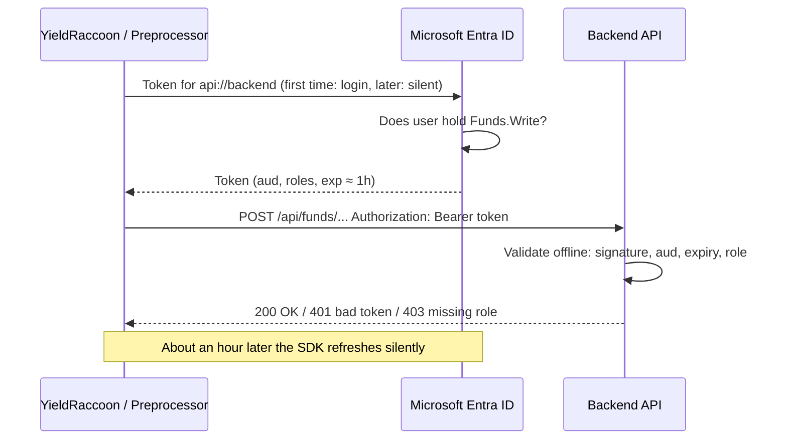

# Backend auth overview

> [!NOTE] Exploration, not a plan
> Notes from a design discussion about replacing the shared backend API key. Nothing here is implemented yet.

## Problem

The write endpoints (`/api/funds/*`, and `/api/embeddings/*` when Cosmos DB is enabled) are protected by one shared string, `EmbeddingApiKey`.

- Backend: [ApiKeyAuthenticationMiddleware.cs](../backend/Backend.API/Middleware/ApiKeyAuthenticationMiddleware.cs) compares `Authorization: ApiKey <key>` against the configured key.
- YieldRaccoon: stores `BackendApiKey` in user settings and sends it from [PresentationModule.cs](../YieldRaccoon/YieldRaccoon.Wpf/Modules/PresentationModule.cs).
- Preprocessor: sends the same key for Cosmos DB uploads.

Goal: something that rotates automatically, with no hardcoded string.

Every `/api/funds` endpoint is a POST write, while `/api/ask` and `/api/ownership-flow` are open. So the auth is already "write-only". Only the mechanism would change.

## Options considered

| Option | Rotates automatically? | Verdict |
| --- | --- | --- |
| Key Vault secret | No. Key Vault auto-rotates only cryptographic *keys*, not secrets. Secret rotation needs your own Function plus Event Grid `SecretNearExpiry`, and every client still needs the new value. | Many moving parts, still a shared secret |
| **Microsoft Entra ID tokens** | Yes. Tokens live about an hour and refresh silently. Nothing is stored. | **Preferred** |
| App Service Easy Auth | Yes | Applies to the whole app, but `/api/ask` must stay anonymous |

> [!TIP]
> The best rotation is no secret at all. The backend already uses `DefaultAzureCredential` for SQL and Cosmos, so this applies the same passwordless idea to our own API.

## Concepts

Both live under **Microsoft Entra ID** in the portal.

| Portal name | Technical name | What it is | Analogy |
| --- | --- | --- | --- |
| App registrations | Application object | Definition of the API: ID `api://<guid>`, app roles, pre-authorized clients | Class |
| Enterprise applications | Service principal | Instance in our tenant: who holds which role | Object |

- An app registration is **not** an app and hosts nothing. It is an identity record for the API: the lock, not the key.
- **Your login** (the `az login` account) is who you are. The **app registration** defines what you can get into.
- It is a different object from the App Service **managed identity**, which is the backend's identity when *it* calls SQL, Cosmos or Key Vault.
- **Tenant** = our private Entra directory. "Tenant only" sign-in means strangers get `AADSTS50020` at the Microsoft login page. Others can be added as created users or invited guests (B2B).
- **Assignment required = Yes** on the enterprise app adds a second gate: even tenant members need a role.

## Proposed flow



The backend never calls Entra per request. It validates tokens offline with Entra's public signing keys, which it downloads once and caches.

### How clients get a token

| | A. Reuse `az login` | B. Own sign-in window |
| --- | --- | --- |
| Credential | `AzureCliCredential` / `DefaultAzureCredential` | `InteractiveBrowserCredential` or MSAL with WAM |
| User sees | Nothing while `az login` is valid | Login popup once, then silent (on-disk token cache) |
| Extra setup | Pre-authorize the Azure CLI client ID (`04b07795-8ddb-461a-bbee-02f9e1bf7b46`) on the API registration | A second, small app registration per client (public client, no secret) |
| Needs Azure CLI | Yes | No |
| Backend can tell which app called | No, it sees "Azure CLI" | Yes, via the `azp` claim |
| Fits | Preprocessor (CLI) | YieldRaccoon (desktop app) |

> [!WARNING] Azure CLI gotcha
> With option A the token is issued *to Azure CLI*. Without pre-authorizing its client ID you get a consent error.

### What goes away

- `BackendApiKey` in YieldRaccoon settings and the Settings window field
- `EmbeddingApiKey` in Key Vault and user secrets
- The custom middleware, replaced by `[Authorize(Policy = "FundsWrite")]`

Revoking access means removing a role assignment.

## Migration: run both schemes side by side

The backend accepts either header during the transition:

```text
Authorization: ApiKey <key>      → old path, treated as holding Funds.Write
Authorization: Bearer <token>    → Entra path, checked for the Funds.Write role
```

- ASP.NET Core supports multiple authentication schemes. A selector routes requests by header prefix.
- Clients switch over one at a time.
- Once logs show no `ApiKey` traffic for a few weeks, delete the key and that code path.

> [!CAUTION]
> While both schemes are active, security is only as strong as the static key. Keep the overlap temporary.

## Visibility

### Clients identify themselves

Neither client sets a `User-Agent` today, and `HttpClient` sends none by default. Proposed:

```text
User-Agent: YieldRaccoon/<version>
User-Agent: Preprocessor/<version>
```

The backend (Azure Monitor OpenTelemetry distro, `UseAzureMonitor` in `Program.cs`) tags the request activity, and the tags land in `customDimensions`:

- `client.app`: taken from the User-Agent
- `auth.scheme`: `ApiKey` or `Bearer`
- With Bearer, also the verified `azp` and user from the token

```kusto
requests
| where timestamp > ago(30d) and url has "/api/funds"
| summarize calls = count(), last_seen = max(timestamp)
    by client = tostring(customDimensions["client.app"]),
       scheme = tostring(customDimensions["auth.scheme"])
```

> [!IMPORTANT]
> User-Agent is self-reported and fine for analytics and versions, but it does not prove identity. The token claims do.

### Where to look in the portal (Microsoft Entra ID)

| Question | Location |
| --- | --- |
| Who holds `Funds.Write` | Enterprise applications → backend API → Users and groups |
| Which clients may request tokens | App registrations → backend API → Expose an API → Authorized client applications |
| Who got tokens, from which app, when, from which IP | Monitoring → Sign-in logs, filtered by resource = backend API |
| Which roles exist | App registrations → backend API → App roles |

Sign-in log tabs: **interactive** (login popup), **non-interactive** (silent refresh), **service principal / managed identity** (automation).

- Free tier keeps logs for **7 days**.
- Entra shows token issuance, not API calls. Per-request detail comes from App Insights.
- API key callers never touch Entra. During the overlap they only appear in App Insights.

## No GUI needed: CLI-only setup

Everything can be scripted, for example in an `entra-setup.sh` next to `azure-setup.sh`:

1. `az ad app create` creates the API registration and sets the identifier URI `api://<app-id>`
2. `az ad app update --app-roles` defines `Funds.Write` (and optionally `Embeddings.Write`)
3. `az rest` → Microsoft Graph sets `api.preAuthorizedApplications` (Azure CLI client ID)
4. `az ad sp create` creates the enterprise app
5. `az rest` → Graph `appRoleAssignedTo` assigns the role to our user

To manage access afterwards: `GET` to list assignments, `DELETE` to revoke. First check that `az ad app list --show-mine` works rather than returning 403.

## Tiers and pricing

Current setup is all free: App Service F1, Static Web Apps Free, SQL Free, Cosmos free tier, App Insights Free.

| Item | Cost |
| --- | --- |
| App registration, app roles, user role assignments | $0 (Entra ID Free) |
| Tokens, any number of requests | $0 |
| JWT validation in the backend | $0, runs in our code on F1 |
| Managed identity, federated credentials | $0 |
| Guest users (B2B) | Free up to 50,000 monthly active users |
| Group-based role assignment, Conditional Access | Entra ID P1, about $6 per user/month (not needed) |
| Workload ID Premium | About $3 per workload identity/month (not needed) |

**Net cost of the change: $0.** It is cheaper than a Key Vault rotation setup.

## Frontend sign-in (parked)

| Login | Own app registration + MSAL | Static Web Apps built-in auth (Free) |
| --- | --- | --- |
| Microsoft account | ✅ $0, protects the backend too | ✅ but only the static pages |
| GitHub account | ❌ Entra can't federate GitHub (plain OAuth2, not OIDC) | ✅ but only the static pages |

- Static Web Apps Free has only preconfigured providers, and the Entra one lets *any* Microsoft account in. Custom registrations and linked backends need the **Standard** plan (about $9/month).
- The Static Web Apps session doesn't reach the App Service backend, so `/api/ask` stays open either way.
- MSAL in the browser works on any tier, including with the Next.js static export.
- Locking `/api/ask` would end public use. For a public demo, rate limiting plus an OpenAI spend cap fits better.

## Other things an app registration can do

1. **Replace `AZURE_WEBAPP_PUBLISH_PROFILE`** with a GitHub OIDC federated credential, on a separate "deployer" registration. This is the next long-lived secret worth removing.
2. Frontend sign-in (see above).
3. Delegated scopes (`access_as_user`) as opposed to app roles.
4. Managed identity or federated credentials for future headless jobs.
5. A Swagger UI "Authorize" button for dev testing.
6. Sign-in logs for visibility.

## Suggested order

1. Backend: accept both `ApiKey` and `Bearer`, and log scheme plus client.
2. Clients send `User-Agent`. Preprocessor uses `az login` (A), YieldRaccoon gets its own sign-in (B).
3. Watch App Insights, then remove `EmbeddingApiKey` and the middleware.
4. Replace the GitHub publish profile with OIDC.

## Related

- [SECRETS-MANAGEMENT.md](SECRETS-MANAGEMENT.md)
- [AZURE-DEPLOYMENT.md](AZURE-DEPLOYMENT.md)
